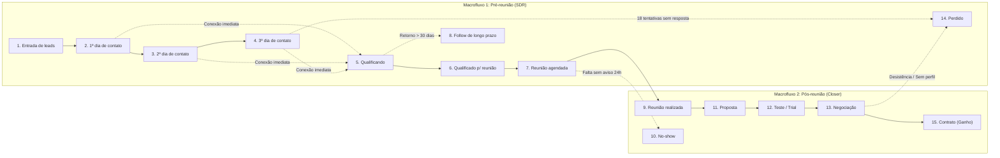
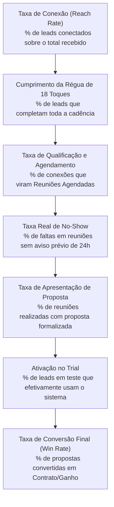

# PRD 001: Estruturação do Pipeline Comercial e Motor de Cadência Operacional

**Status:** Aprovado para Especificação Técnica  
**Data:** 16 de setembro de 2026  
**Autores / Stakeholders:**
- **Erivelton:** Consultor Comercial (Desenho de Processo e Metodologia Atento)
- **Alana Alexandre:** Liderança Comercial (Gestão da Operação e Estratégia Comercial MedGuia)
- **Karol:** Operação Comercial (SDR / Closer MedGuia)
- **Raniery Fialho:** Desenvolvedor / Engenharia de Software (Implementação Técnica do CRM)
- **Caetano Lima:** Gestão de Cronograma e Operações

---

## 1. Visão Executiva (Executive Summary)

A **MedGuia** está em fase de expansão e consolidação de sua máquina de vendas. Para sustentar a escala de um negócio SaaS/Startup, a operação comercial precisa transitar de uma abordagem artesanal, centrada na memória e dedicação individual, para um **processo padronizado, previsível e orientado a eventos**.

> [!IMPORTANT]
> **Premissa Fundamental: Adaptação de Produto Existente (Não partimos do zero):**  
> A MedGuia **já possui uma plataforma de CRM operacional** com fluxo de Kanban básico, manipulação de cards, registro de notas e base de contatos ativos em uso diário por Karol. Esta iniciativa **não constrói um novo CRM do zero**, mas sim **reestrutura, adapta e evolui funcionalmente a plataforma existente** para internalizar as regras de negócio, etapas especializadas e a mecânica de cadência da Consultoria Comercial Atento.

> [!NOTE]
> **Foco Exclusivo no Problema e nas Regras de Negócio:**  
> Este documento restringe-se a responder **O QUÊ**, **PARA QUEM** e **POR QUÊ**. A especificação de arquitetura, modelagem de banco de dados, endpoints ou componentes de interface será detalhada separadamente no RFC (Request for Comments) e no TDD (Technical Design Document).

---

## 2. O POR QUÊ? (Contexto e Definição do Problema)

### 2.1 O Cenário Atual (As-Is): A Ferramenta Existente e os Gaps de Processo
A MedGuia já opera seu ciclo comercial sobre uma solução própria de CRM em formato Kanban. A ferramenta atual já provê a gestão visual de cards, entrada de novos leads e campo para histórico/notas. Contudo, essa base tecnológica operava desacoplada de uma metodologia comercial estrita, apresentando os seguintes gaps:

1. **Ausência de Cadência Guiada no CRM Atual:**  
   O sistema atual exibia apenas a oportunidade em tela, sem direcionar o operador sobre *qual ação realizar*, *em qual turno* e *por qual canal*. Karol precisava recorrer a controles externos ou à própria memória para saber se um lead já havia recebido uma, duas ou cinco ligações, gerando sobrecarga cognitiva e inconsistência no volume de tentativas.
2. **Desistência Precoce e Falta de Insistência Estruturada:**  
   Estudos de mercado de vendas comprovam que a maior taxa de conexão com decisores ocorre a partir do **9º ponto de contato**, enquanto operadores sem cadência automatizada costumam desistir antes da 6ª tentativa. No CRM atual, não havia mecanismo para garantir e contabilizar as 18 tentativas necessárias.
3. **Avanço no Funil por Expectativa em vez de Fato:**  
   Como as colunas do CRM atual eram genéricas e não possuíam travas ou critérios de aceite objetivos, cards eram movidos com base em suposições (ex.: mover para negociação sem que houvesse proposta formalizada ou reunião concluída de fato).
4. **Tratamento Inexistente de Exceções Operacionais:**  
   Reuniões com ausência de cliente (*No-show*) e pedidos de contato futuro (*Follow de longo prazo > 30 dias*) não tinham destino próprio na ferramenta, ficando misturados aos leads quentes ou sendo esquecidos.
5. **Concessão Indiscriminada de Testes (*Trial*):**  
   Leads avançavam para o teste gratuito da ferramenta MedGuia sem que uma proposta financeira tivesse sido formalizada ou sem alinhamento de compromisso, gerando esforço de suporte para contas que esfriavam sem uso.
6. **Incompatibilidade com o Crescimento da Equipe (Escala):**  
   Por não ter o processo "engessado" no software, a operação funcionava apenas porque Karol detinha o histórico tácito na cabeça. Caso entrassem 3, 5 ou 10 novos vendedores, a ferramenta atual não seria capaz de orientá-los ou auditar a produtividade individual.

### 2.2 As Dores Centrais do Negócio
1. **Dependência Crítica de Atuação Pessoal:** Se o operador mudar ou se ausentar, o fluxo comercial colapsa por falta de padronização embutida no sistema.
2. **Cegueira Gerencial e Falta de Confiabilidade nas Métricas:** Sem etapas rígidas e campos mandatórios (ex.: motivo de descarte, valor da proposta), a liderança não consegue mapear as taxas reais de conversão do funil.
3. **Desperdício de Leads Qualificados:** Leads caros gerados pelo marketing são perdidos prematuramente por falta de uma esteira multicanal disciplinada de 18 toques em 3 dias.

### 2.3 O Custo da Inação
Continuar operando o CRM existente no modelo aberto ("freestyle") impedirá a MedGuia de expandir sua equipe comercial, manterá o custo de aquisição de clientes (CAC) elevado e continuará gerando atrito e estresse na rotina do operador.

---

## 3. PARA QUEM? (Personas e Beneficiários)

| Persona | Papel na Operação | Necessidades e Dores que a Adaptação do CRM Deve Atender |
| :--- | :--- | :--- |
| **SDR / Pré-vendedor(a)** *(Karol atualmente, futuros SDRs)* | Executar o primeiro contato, cumprir a cadência de prospecção, qualificar oportunidades e agendar reuniões com o decisor. | - Receber a lista diária de tarefas dividida por turnos (manhã e tarde) dentro do próprio CRM. - Não precisar lembrar manualmente de quantas tentativas faltam para cada lead. - Ao marcar uma atividade como concluída, ter o próximo bloco automaticamente disponibilizado. - Ter critérios claros para encerrar contato com leads sem resposta (*breakup* e descarte). |
| **Closer / Executivo(a) de Fechamento** *(Karol atualmente, especialistas futuros)* | Conduzir a reunião de demonstração/venda, apresentar proposta de valor, gerenciar testes e fechar contratos. | - Receber apenas leads qualificados com horário confirmado na agenda. - Consultar no histórico do card as anotações e os prints de interações anteriores. - Ter etapas bem delineadas de Proposta, Teste e Negociação, garantindo que nenhum lead fique estagnado sem data de retorno. |
| **Liderança Comercial e Consultoria** *(Alana Alexandre - Liderança Comercial MedGuia, Erivelton - Consultor Comercial, Caetano Lima)* | Gerenciar metas, prever faturamento, calibrar o funil e integrar novos vendedores de forma rápida. | - Processo padronizado e auditável no software, sem permissão para que vendedores criem colunas livres ou alterem o fluxo padrão. - Garantir que todos os 18 pontos de contato sejam tentados antes de um lead ser considerado perdido. - Higiene de dados: métricas reais de agendamento, no-show com regra de 24h, propostas formalizadas e motivos de perda estruturados. |
| **Lead / Prospect (Médico ou Gestor de Clínica)** | Decisor que avalia a solução MedGuia para sua clínica ou consultório. | - Contato ágil, profissional e respeitoso, sem abordagens caóticas ou desordenadas. - Convite formal e tempestivo para reunião via calendário. - Transparência sobre proposta financeira antes de ingressar no período de teste gratuito. |

---

## 4. O QUÊ? (Visão do Produto e Proposta de Valor)

### 4.1 Definição do Produto: Adaptação Funcional da Plataforma de CRM Existente
O produto consiste na **reestruturação funcional e comportamental do CRM atual da MedGuia**, transformando seu quadro Kanban existente em um **sistema orientado a eventos e cadência operacional guiada**.

A intervenção adapta o software atual para incorporar:
1. **Nova Grade de 15 Etapas Estritas:** Substituição das colunas genéricas anteriores pela sequência padronizada do Playbook Comercial da Atento.
2. **Motor de Cadência por Blocos Operacionais:** O CRM passa a organizar e liberar tarefas estruturadas por turno (manhã e tarde), avançando a cada check do operador.
3. **Gatilhos de Avanço por Fato Ocorrido:** O sistema impede movimentações baseadas em expectativa, exigindo a confirmação de fatos reais (ex.: conexão estabelecida, reunião de no mínimo 10 min, proposta anexada).
4. **Governança e Higiene Operacional:** Campos obrigatórios de valor de oportunidade, motivos de encerramento padronizados e suporte a anexo/colagem de prints de conversas manuais.

### 4.2 Proposta de Valor
Converter o CRM existente em uma ferramenta que **guia ativamente a rotina do time**, entregando:
- **Menos improviso:** O operador abre o CRM e sabe exatamente o que fazer a cada momento do dia.
- **Mais velocidade:** Tarefas agrupadas por blocos e canais otimizados (voz + WhatsApp).
- **Mais rastreabilidade:** Fatos devidamente documentados, viabilizando métricas gerenciais auditáveis para a liderança.

---

## 5. Regras de Negócio e Requisitos Funcionais

### 5.1 Macrofluxo Padronizado do Pipeline (Kanban)
O pipeline do CRM existente deve ser reconfigurado para adotar um desenho único, linear e restrito. **A customização livre de colunas por parte dos operadores é expressamente proibida.**

#### Definições e Critérios das Etapas:
1. **Entrada de leads:** Recepção de novas oportunidades de todas as origens, aguardando início da abordagem ativa.
2. **1º dia de contato:** Inicia o 1º dia da cadência ativa, liberando o bloco da manhã.
3. **2º dia de contato:** Continuidade da cadência caso não tenha havido contato no 1º dia.
4. **3º dia de contato:** Último dia da cadência ativa inicial, culminando na mensagem de encerramento (*breakup*).
5. **Qualificando:** O operador conseguiu conexão humana com o lead. **A cadência é imediatamente paralisada.** O operador mapeia necessidades, dores e perfil da clínica.
6. **Qualificado pronto para reunião:** Perfil validado com sucesso, aguardando confirmação de agenda. É etapa prioritária de atendimento.
7. **Follow de longo prazo:** Lead contatado que demonstrou interesse real, mas solicitou recontato em prazo superior ou igual a 30 dias. **Regra obrigatória:** Todo card nesta etapa deve possuir uma tarefa futura de retorno com data agendada.
8. **Reunião agendada:** Data e horário confirmados com o envio formal de convite (*invite*) no calendário do decisor.
9. **No-show:** O prospect não compareceu ao horário agendado.
   - *Regra de 24 horas:* Se o prospect solicitar remarcação com pelo menos 24 horas de antecedência, **não** se computa no-show; o card permanece em *Qualificado pronto para reunião*.
10. **Reunião realizada:** A apresentação de vendas ocorreu com duração mínima de **10 minutos** com o Closer.
11. **Proposta:** Valor financeiro, condições de contratação e escopo apresentados formalmente ao cliente.
    - *Regra obrigatória:* Toda reunião realizada deve ter uma proposta formalizada (mesmo se apresentada na própria sessão), para calibrar as taxas de conversão da MedGuia.
12. **Teste (Trial):** Concessão de período de uso prático do sistema MedGuia após apresentação da proposta, permitindo validação prática pelo cliente antes da assinatura.
13. **Negociação:** Ajuste de valores, condições de parcelamento, prazos contratuais e tomada de decisão.
14. **Contrato (Ganho):** Fechamento formalizado, contrato assinado ou primeiro pagamento compensado.
15. **Perdido:** Oportunidade encerrada (por esgotamento de 18 tentativas de cadência, falta de orçamento, falta de fit ou perda para concorrência).

---

### 5.2 O Motor de Cadência Operacional (18 Touchpoints em 3 Dias)
O CRM deve organizar a rotina do operador em **dois turnos diários (Manhã e Tarde)**, com o telefone sendo o canal principal e o WhatsApp como suporte imediato.

#### Matriz de Cadência Operacional:

| Dia | Turno | Atividades do Bloco | Canais Utilizados | Total Acumulado |
| :---: | :---: | :--- | :--- | :---: |
| **1º Dia** | **Manhã** | Ligação 1 + Ligação 2 + WhatsApp 1 | Telefone + WhatsApp | 3 tentativas |
| **1º Dia** | **Tarde** | Ligação 3 + Ligação 4 + WhatsApp 2 | Telefone + WhatsApp | 6 tentativas |
| **2º Dia** | **Manhã** | Ligação 5 + Ligação 6 + WhatsApp 3 | Telefone + WhatsApp | 9 tentativas |
| **2º Dia** | **Tarde** | Ligação 7 + Ligação 8 + WhatsApp 4 | Telefone + WhatsApp | 12 tentativas |
| **3º Dia** | **Manhã** | Ligação 9 + Ligação 10 + WhatsApp 5 | Telefone + WhatsApp | 15 tentativas |
| **3º Dia** | **Tarde** | Ligação 11 + Ligação 12 + **WhatsApp 6 (Breakup)** | Telefone + WhatsApp | **18 tentativas** |

> [!NOTE]
> **Mensagem de Breakup:** Comunicação final educada e desapegada, informando que a MedGuia suspenderá as tentativas ativas para não incomodar, mantendo o canal aberto caso o lead deseje atendimento futuro.

#### Lógica de Liberação de Tarefas por Blocos:
- As 18 atividades não aparecem acumuladas de início na tela do operador.
- O sistema apresenta as 3 tarefas correspondentes ao bloco do turno vigente.
- À medida que o operador conclui (*dá check*) nas ações da manhã, o CRM desbloqueia o bloco da tarde.
- Ao final do dia sem contato, o card avança para a coluna do dia seguinte, liberando o bloco matutino subsequente.
- Esgotadas as 18 tentativas sem sinal do lead, o sistema direciona a oportunidade para **Perdido**, com a opção de criar um lembrete para revisitar o contato após 30 a 60 dias.

---

### 5.3 Regras de Ouro e Políticas de Governança

1. **Regra de Ouro de Interrupção Imediata da Cadência:**  
   Assim que o lead atender ao telefone ou interagir no WhatsApp, a cadência ativa cessa de imediato. O card é movido para **Qualificando**. Não se deve executar tentativas remanescentes.
2. **Avanço por Fato Ocorrido (Nunca por Expectativa):**  
   Atividades só podem ser marcadas como concluídas após sua realização fática. Não é permitido adiantar tarefas com base na intenção de realizá-las.
3. **Higiene Mandatória do CRM:**
   - **Registro com Evidência (Print de Conversa):** Para contatos manuais efetuados fora da esteira automática (ex.: retorno avulso de mensagem), o operador deve anexar obrigatoriamente a captura de tela da conversa nas notas do card.
   - **Valor Obrigatório:** É obrigatório o preenchimento do valor do plano na etapa de *Proposta*.
   - **Motivo de Perda Estruturado:** Não é permitido mover um card para *Perdido* sem marcar o motivo correspondente em uma lista padronizada de opções.
   - **Vedação a Cards Órfãos:** Cards em *Follow de longo prazo*, *Proposta*, *Teste* e *Negociação* devem obrigatoriamente possuir uma próxima ação agendada.
4. **Política de Teste Gratuito (Trial):**  
   O acesso ao teste prático deve ocorrer após a apresentação da proposta, evitando custos com usuários que não possuem intenção real de contratação.

---

## 6. Métricas de Sucesso e Indicadores (KPIs)

A eficácia da reestruturação do CRM existente será avaliada por:

---

## 7. Escopo da Iniciativa

### 7.1 No Escopo (In-Scope)
- **Adaptação da Estrutura do CRM Existente:** Reconfiguração das colunas e etapas do quadro Kanban atual para as 15 etapas padronizadas.
- **Mecanismo de Cadência de 18 Touchpoints:** Adaptação da camada de tarefas do produto atual para suportar blocos por turno (manhã/tarde).
- **Gatilho de Interrupção Imediata:** Regra para desviar cards para *Qualificando* no primeiro contato realizado com sucesso.
- **Regras de Exceção:** Tratamento específico de *No-Show* (com tolerância de aviso de 24h) e *Follow-up longo prazo* (com data futura obrigatória).
- **Higiene e Validações:** Suporte a anexação/colagem rápida de prints nas notas e campos mandatórios de valor de proposta e motivo de perda.
- **Migração e Transição Operacional dos Cards Atuais:** Plano de alocação dos cards já existentes no CRM para as novas colunas sem perda de histórico.
- **Validação com Card de Teste:** Execução de teste piloto no ambiente homologado antes do uso oficial pela equipe.

### 7.2 Fora do Escopo (Out-of-Scope)
- **Desenvolvimento de um Novo CRM do Zero:** A base de código, autenticação, armazenamento e interface existente serão mantidos e adaptados.
- **Arquitetura Técnica e Implementação de Software:** Escolha de banco de dados, escrita de código, endpoints ou refatorações de backend (objeto de RFC e TDD).
- **Integração Telefônica Automática (Discador VoIP Nativo):** O operador continua realizando chamadas via telefone/softphone habitual e registrando o resultado no sistema.
- **Disparo Automatizado em Massa de WhatsApp via API Oficial:** A interação permanece humanizada, conduzida pelo operador conforme os padrões do playbook.

---

## 8. Riscos e Premissas de Transição

| Risco Mapeado | Impacto | Estratégia de Mitigação |
| :--- | :---: | :--- |
| **Impacto sobre leads atualmente em andamento no CRM** | Alto | Mapear previamente para quais novas colunas os cards já existentes serão migrados, evitando duplicidade de contato ou perda de contexto. |
| **Tentativa de customização individual de colunas por operadores** | Alto | O desenho do pipeline deve ser travado funcionalmente ("engessado"), sem permissão para que usuários criem colunas paralelas. |
| **Burla ao registro de atividades (marcar sem ligar)** | Médio | Regras de higiene claras: tarefas fora da cadência exigem print da conversa, e reuniões exigem convite formal no calendário. |
| **Resistência inicial ao volume de 18 tentativas** | Médio | Apresentação dos dados de conversão e facilidade da automação por blocos, que desonera o operador do controle manual. |

---

## 9. Checklist Operacional de Uso Rápido (Guia do Operador)

| Situação Real da Oportunidade no Momento | Etapa Correta no CRM Adaptado |
| :--- | :--- |
| O lead acabou de chegar e nenhuma tentativa foi feita? | **Entrada de leads** |
| Iniciando tentativas do 1º, 2º ou 3º dia de abordagem? | **1º, 2º ou 3º dia de contato** |
| O lead atendeu a ligação ou respondeu à mensagem? | **Qualificando** *(sai da cadência na hora)* |
| Levantamento concluído e perfil aprovado para reunião? | **Qualificado p/ reunião** |
| Lead pediu retorno formal daqui a mais de 30 dias? | **Follow-up longo prazo** *(com tarefa agendada)* |
| Data e horário definidos e convite formal enviado? | **Reunião agendada** |
| O cliente faltou ao horário marcado sem avisar 24h antes? | **No-show** |
| A reunião aconteceu e durou pelo menos 10 minutos? | **Reunião realizada** |
| O valor e escopo da solução foram formalizados e enviados? | **Proposta** *(valor preenchido obrigatoriamente)* |
| O cliente iniciou a avaliação prática da ferramenta MedGuia? | **Teste** |
| Negociação em andamento sobre termos, parcelamento ou plano? | **Negociação** |
| O cliente assinou o contrato ou confirmou o fechamento? | **Contrato (Ganho)** |
| Oportunidade encerrada ou sem retorno após 18 tentativas? | **Perdido** *(com motivo selecionado obrigatoriamente)* |

---

## 10. Próximos Passos e Rito de Transição

1. **Validação deste PRD** com a Liderança Comercial (Alana Alexandre), Consultoria Comercial (Erivelton) e Operação (Karol), com alinhamento de requisitos técnicos com o Desenvolvedor (Raniery Fialho).
2. **Elaboração da Especificação Técnica (RFC / Tech Spec)** em `/docs/rfcs`, detalhando as adaptações necessárias no schema, rotas e componentes do CRM já existente.
3. **Elaboração do TDD (Technical Design Document)** em `/docs/tdds`.
4. **Homologação Prática com "Card de Teste":** Criação de um card fictício para percorrer todos os blocos de cadência e gatilhos antes do rollout oficial para Karol.
5. **Transição dos Leads Atuais:** Reclassificação dos leads já existentes no CRM para suas respectivas novas etapas.
