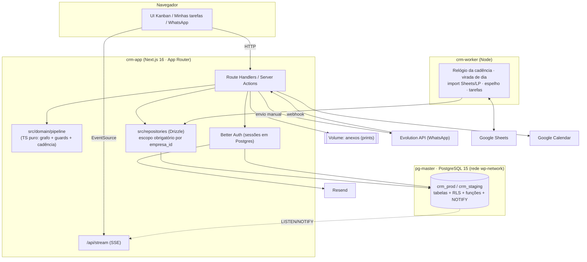
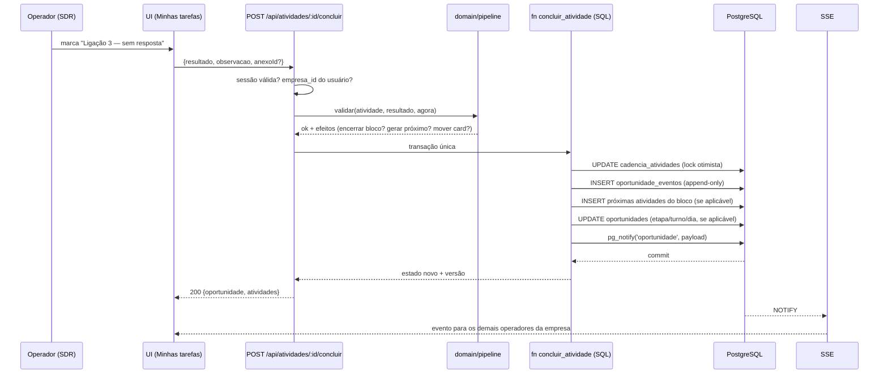
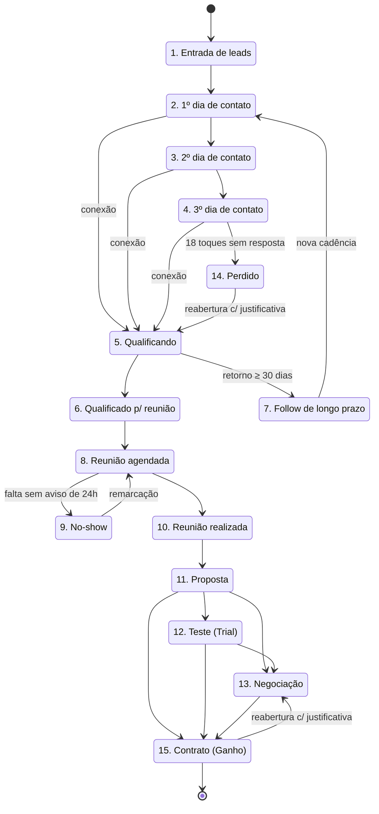
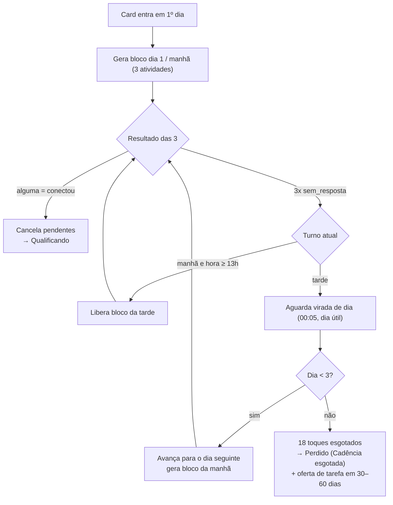
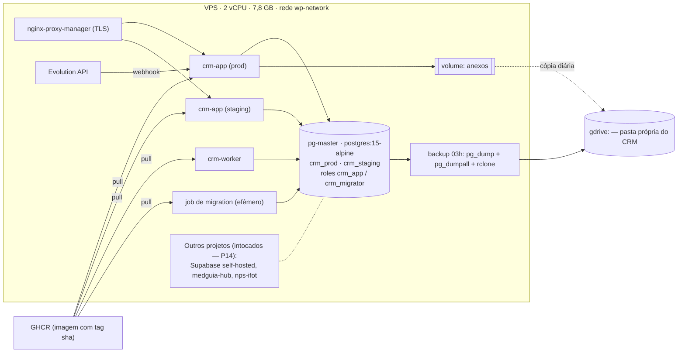
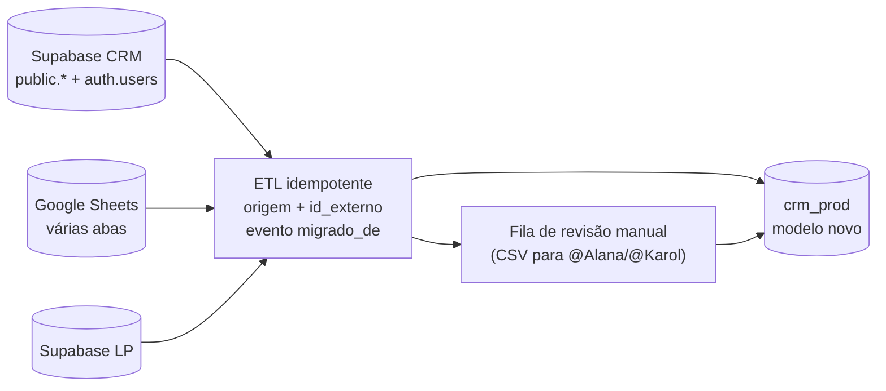
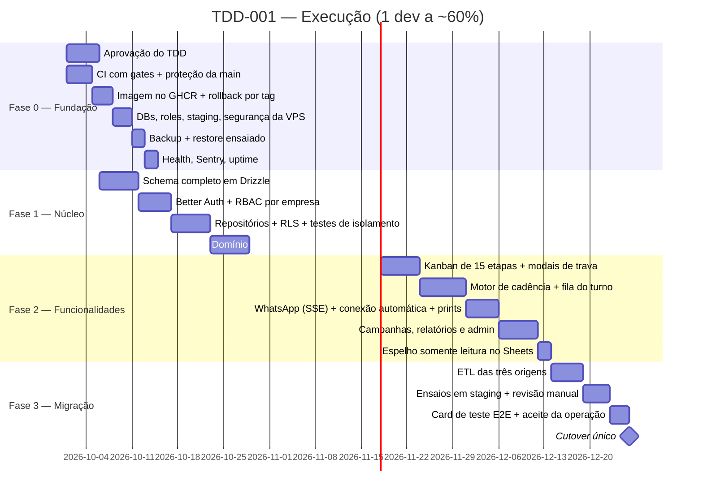

# TDD 001 — Pipeline Comercial Orientado a Eventos sobre PostgreSQL Próprio

| Campo | Valor |
|---|---|
| **Tech Lead / Driver** | @Raniery Fialho — Engenharia de Software |
| **Product / Negócio** | @Alana Alexandre (Liderança Comercial) · @Erivelton (Consultor Comercial — Playbook Atento) |
| **Operação / Usuária principal** | @Karol (SDR/Closer) |
| **Cronograma** | @Caetano Lima |
| **Time de engenharia** | 1 desenvolvedor (@Raniery) a ~60% (P5 do RFC-001) |
| **Épico / Ticket** | A criar — features especificadas via `onp-spec-driven` (`.spec/`) |
| **Status** | Draft — aguarda aprovação do RFC-001 (reunião de decisão em 2026-09-30) |
| **Criado em** | 2026-09-17 |
| **Última atualização** | 2026-09-17 |
| **Documentos-fonte** | [PRD-001](../prds/PRD-001-pipeline-comercial-cadencia.md) · [RFC-001](../rfcs/RFC-001-pipeline-comercial-cadencia-e-infra.md) · `.spec/constituicao.md` |
| **Decisões implementadas** | **D2** (PostgreSQL próprio + auth na aplicação) · **A2** (pipeline orientado a eventos) · **B2** (esteira de entrega na VPS) · sub-decisões **D-S1…D-S9** |

> [!IMPORTANT]
> Este TDD responde **COMO** construir. O **O QUÊ/POR QUÊ** está no PRD-001 e as **alternativas descartadas** no RFC-001. Aqui documentam-se contratos, schema, máquinas de estado, topologia e planos operacionais — não código de implementação.

> [!WARNING]
> **Pré-condição de execução:** este TDD só entra em implementação após o **outcome** do RFC-001 (§12) registrar D2 + A2 + B2 aprovados. Qualquer decisão diferente invalida as seções 5, 8, 11 e 17.

---

## 1. Contexto

### Situação atual

A MedGuia opera um CRM em Kanban (Next.js 16 App Router, ~11k linhas) cuja **fonte de verdade é o Google Sheets** para empresas com `usa_sheets=true`, com um Supabase Cloud complementar e um segundo projeto Supabase (landing page) lido na mesma rota. O funil tem 9 colunas fixas no front-end, o status é texto livre normalizado por um mapa, as transições acontecem por drag & drop sem validação de servidor e **não existe log de eventos, entidade de atividade nem tarefa**. Consultas ao banco são feitas **diretamente do navegador** via `supabase-js`, e o papel RBAC do usuário mora em `user_metadata` do JWT, usado em 35 pontos do código.

A infraestrutura é uma VPS de **2 vCPU / 7,8 GB RAM / 96 GB de disco**, com deploy por `scp` + `docker compose build --no-cache` **na própria VPS**, sem CI, sem testes, sem ambiente de homologação, sem migrations versionadas e sem rollback. Na mesma VPS roda o container `pg-master` (PostgreSQL 15.18 Alpine, rede `wp-network`), hoje usado por outros projetos, **sem backup** e com a porta 5432 publicada em `0.0.0.0` num host com `ufw` inativo.

### Domínio

Vendas B2B (*sales engagement*): prospecção ativa multicanal, cadência de toques, qualificação, agendamento, proposta, trial e fechamento — para clínicas e consultórios médicos. O sistema é **multi-tenant** (várias empresas clientes), mas o pipeline é **global e idêntico para todos os tenants** (Q5).

### O que este projeto faz

Reescreve o núcleo do CRM para que o **PostgreSQL próprio na VPS** seja a fonte de verdade única, com um **modelo orientado a eventos** que aplica no servidor as 15 etapas e os 18 touchpoints do Playbook Atento, substituindo Supabase (dados, auth, realtime, storage) por componentes explícitos, e entrega junto a esteira de qualidade (CI, testes, staging, migrations, backup, rollback) que a operação de banco próprio exige.

### Stakeholders

| Quem | Por que se importa |
|---|---|
| @Karol e futuros SDRs/Closers | A rotina diária passa a ser guiada pelo sistema; login e telas mudam de uma vez |
| @Alana / @Erivelton | Regras do Playbook aplicadas de fato; KPIs do PRD §6 auditáveis |
| @Caetano | ~4,5–5 meses sem entrega visível e uma janela de parada de ~4h |
| @Raniery | Passa a operar banco, auth e backup próprios |
| Administradores das empresas clientes | Isolamento multi-tenant e continuidade dos dados |

---

## 2. Definição do Problema e Motivação

### Problemas que resolvemos

1. **As regras do PRD-001 são inaplicáveis na arquitetura atual.**
   Não há integridade transacional, relógio confiável, controle de concorrência nem histórico de eventos. Qualquer pessoa com acesso à planilha burla uma trava editando uma célula.
   *Impacto:* as 15 etapas viram "colunas renomeadas"; os KPIs do PRD §6 continuam não calculáveis.

2. **Cadência de 18 toques não tem onde existir.**
   Não há entidade de atividade, turno ou tentativa. O operador guarda o estado na memória.
   *Impacto:* desistência antes do 6º toque, enquanto a conexão sobe a partir do 9º (PRD §2.1.2) — leads pagos desperdiçados.

3. **Dependência do Supabase espalhada e acoplada.**
   ~25 arquivos com `supabase-js`, 7 chamadas de Auth, 3 canais Realtime, 35 usos de `user_metadata` e **consultas do navegador direto ao banco**, onde a segurança depende inteiramente das policies de RLS estarem corretas.
   *Impacto:* a superfície de vazamento entre tenants é a UI; e cada tabela nova do pipeline encareceria uma saída futura.

4. **Esteira de entrega sem rede de proteção.**
   Sem CI, testes, staging, migrations versionadas ou rollback. 6 commits de correção de deploy em 4 dias (07–10/07/2026); o build de 4 GB de heap disputa memória com a produção.
   *Impacto:* impossível ensaiar a migração ou executar o "card de teste" do PRD §10.4 antes do rollout.

5. **Banco exposto e sem backup (achados de 17/09/2026).**
   `pg-master` publica 5432 em `0.0.0.0`, `ufw` inativo, todos os projetos conectam com o superusuário `admin`, e o cron de backup cobre apenas o `supabase-db` de outro projeto.
   *Impacto:* hospedar o CRM nesse cluster sem corrigir isso transformaria um achado de segurança em perda total de dados comerciais.

### Por que agora

- **Negócio:** PRD aprovado em 16/09/2026; a expansão do time comercial depende dele.
- **Técnico:** criar ~9 tabelas novas e reescrever a rota de leads **sobre o Supabase** e migrar depois significa fazer o mesmo trabalho duas vezes. A refatoração da camada de dados que o pipeline exige **é** a saída do Supabase (RFC §1.5).
- **Operacional:** a transição dos cards existentes (PRD §7.1) exige ensaio em homologação, que hoje não existe.

### Impacto de não resolver

| Dimensão | Consequência |
|---|---|
| **Negócio** | CAC segue alto; equipe comercial não escala além de 1 operador; liderança sem métricas confiáveis |
| **Técnico** | Acoplamento ao Supabase cresce (Storage, `pg_cron`, novas policies); rota de 752 linhas fica mais frágil |
| **Segurança** | Porta 5432 aberta e cluster sem backup permanecem |
| **Usuários** | Karol continua sustentando o processo por memória própria |

---

## 3. Escopo

### ✅ No escopo (entrega única — cutover)

**Plataforma de dados e autenticação (D2)**
- Schema completo novo em Drizzle ORM sobre `crm_prod`/`crm_staging` no `pg-master`, com roles dedicadas `crm_app` (DML) e `crm_migrator` (DDL).
- Autenticação própria com **Better Auth** (e-mail/senha, convite, reset, sessões em Postgres), e-mails transacionais via **Resend**.
- RBAC por empresa em tabelas (`usuarios`, `empresas_usuarios`), substituindo `user_metadata`.
- Camada de repositórios **exclusivamente no servidor**; zero acesso do navegador ao banco.
- Isolamento multi-tenant em profundidade: filtro obrigatório por `empresa_id` no repositório **+** RLS com `current_setting('app.empresa_id')`.
- SSE (`LISTEN/NOTIFY`) no lugar dos 3 canais Realtime.
- Armazenamento de anexos em volume Docker com URLs assinadas pela aplicação.

**Pipeline e cadência (A2)**
- 15 etapas fixas (seed imutável) na ordem do PRD §5.1, com macrofluxo SDR/Closer.
- Máquina de estados com grafo de transições explícito (Q8) e *guards* de negócio (valor, motivo, próxima ação, duração de reunião).
- Motor de cadência de 18 toques, **gerados bloco a bloco** (3 por turno), com turnos 08–12h / 13–18h, seg–sex, `America/Sao_Paulo`, pausa em feriados nacionais.
- Interrupção imediata da cadência em qualquer `conectou`, inclusive por **WhatsApp de entrada** detectado no webhook da Evolution API.
- Log de eventos **append-only** (`oportunidade_eventos`) como base dos KPIs do PRD §6.
- Tarefas agendadas (follow de longo prazo, revisitar perdido em 30–60 dias) e fila "Minhas tarefas" do turno vigente.
- Regra de No-show com tolerância de 24h e reabertura de Perdido/Ganho com justificativa obrigatória (Q9).
- Anexos/prints obrigatórios nos pontos definidos pelo PRD §5.3.
- Ingestão idempotente a partir do Google Sheets e do Supabase da LP; **espelho somente leitura** no Sheets a cada 15 min (Q7).

**Esteira de entrega (B2)**
- CI no GitHub Actions com gates: lint → typecheck → testes (Vitest, com Postgres service container) → build.
- Imagem publicada no GHCR com tag `sha`; VPS apenas faz `pull` + `up`; rollback por tag.
- Ambiente de **staging** (`crm_staging`) recriável a partir de dump anonimizado.
- Migrations versionadas (drizzle-kit), aplicadas por job efêmero antes do deploy, em padrão *expand/contract*.
- Backup diário às 03h (`pg_dump` do CRM + `pg_dumpall` do cluster) com `rclone` para o remote `gdrive:`, checksum, retenção 7 diários + 4 semanais, alerta por WhatsApp e **restore ensaiado**.
- Endpoint de saúde, logs estruturados, Sentry e monitor de uptime externo.
- Correções de infraestrutura R-VPS-1/2/3 (fechar 5432, ativar firewall, rotacionar credenciais, backup do cluster, roles sem superusuário).

**Migração**
- ETL idempotente de três origens (Supabase, Google Sheets, Supabase LP) para o modelo novo, com `origem + id_externo` e evento `migrado_de`.
- Mapeamento das situações antigas para as 15 etapas, com fila de revisão manual para @Alana/@Karol.
- Cutover único com freeze, ETL final, deploy, virada e reset de senhas.

### ❌ Fora do escopo (V1)

- **CRM novo do zero** — a base Next.js, as telas e a integração com Evolution API são adaptadas (PRD §7.2).
- **Discador VoIP nativo** — ligações seguem no telefone/softphone, com registro manual do resultado.
- **Disparo automatizado em massa de WhatsApp** — a interação segue humanizada; apenas a **detecção de mensagem recebida** é automática.
- **Migração de hashes de senha** — todos redefinem a senha no cutover (Q11).
- **Migração do projeto Supabase da LP** — permanece no Supabase, lido pelo import (D-S8/P13).
- **Migração dos outros projetos da VPS para roles sem superusuário** — fica como recomendação (R-VPS-3).
- **PITR / WAL contínuo** — RPO de 24h aceito pelo Driver (Q12); subir para horário é mudança de uma linha de cron.
- **Pipeline customizável por tenant** — o funil é global (Q5).
- **Rollout gradual por empresa** — o cutover é *big-bang* (RFC §8).
- **App mobile nativo** — a UI responsiva atual atende.

### 🔮 Considerações futuras (V2+)

- Frequência de backup horária ou PITR com pgBackRest, se a liderança recusar o RPO de 24h.
- Migração do objeto de armazenamento para MinIO ou Cloudflare R2 se o volume de prints crescer (D-S5).
- Funis customizáveis por tenant, caso P3 seja invalidada.
- Relatórios avançados e forecast a partir do log de eventos.
- Integração com discador e API oficial de WhatsApp, se o PRD §7.2 for revisto.

---

## 4. Solução Técnica

### 4.1 Visão de arquitetura

**Princípio central:** existe **um único ponto de escrita** para o estado do pipeline — um endpoint de transição que delega a um módulo de domínio TypeScript puro e persiste por função SQL transacional. UI, importador, worker e webhook **todos** passam por ele. Nenhum caminho alternativo escreve etapa de card.

**Componentes**

| Componente | Responsabilidade |
|---|---|
| **UI (App Router, Client Components)** | Renderização, interação, otimismo local. Consome exclusivamente as rotas HTTP do próprio app; **nenhum acesso a banco** |
| **Route Handlers / Server Actions** | Fronteira HTTP: autenticação de sessão, resolução do tenant, validação de entrada, tradução de erros de domínio para respostas |
| **`src/domain/pipeline`** | Módulo TypeScript **puro** (sem I/O): grafo de transições, *guards*, geração de blocos de cadência, cálculo de turno/dia útil. Reutilizado pela UI para desabilitar ações inválidas |
| **`src/repositories`** | Acesso a dados via Drizzle; **exige `empresa_id`** em toda consulta; define `app.empresa_id` na sessão da transação |
| **Funções SQL transacionais** | `mover_oportunidade`, `concluir_atividade`: gravam estado + evento atomicamente, com lock otimista (`version`) |
| **`crm-worker`** (container Node) | Relógio da cadência, virada de dia, importação do Sheets/LP, espelho somente leitura, tarefas agendadas, alertas de backup |
| **Auth (Better Auth)** | Sessões em Postgres, convite, reset, rate limit de login; e-mails via Resend |
| **Barramento de eventos (`LISTEN/NOTIFY` → SSE)** | Notifica clientes conectados sobre mudanças de card e mensagens de WhatsApp |
| **Armazenamento de anexos** | Volume Docker; a aplicação emite URLs assinadas de curta duração |
| **Integrações** | Evolution API (WhatsApp, entrada e saída), Google Sheets (ingestão + espelho), Google Calendar (evidência de reunião), Resend (e-mail) |



### 4.2 Fluxo de dados — conclusão de atividade e transição



**Caso "conectou" (Regra de Ouro, PRD §5.3.1):** o domínio devolve o efeito *encerrar cadência*; na mesma transação, todas as atividades pendentes da oportunidade viram `cancelada`, o card vai para **Qualificando** e o evento `conexao_estabelecida` é gravado com o canal de origem.

### 4.3 Modelo de dados

> Nomes de tabelas e colunas em português, alinhados ao domínio já existente. Toda tabela de negócio carrega `empresa_id` e é coberta por RLS. Timestamps são `timestamptz`; a aplicação opera em `America/Sao_Paulo`.

#### Tabelas de identidade e tenant

| Tabela | Campos principais | Observações |
|---|---|---|
| `empresas` | `id`, `nome`, `slug`, `ativo`, timestamps | Tenant raiz |
| `empresa_configuracoes` | `empresa_id`, `chave`, `valor` (JSONB) | Substitui a configuração atual |
| `usuarios` | `id` (UUID **preservado** do Supabase), `email` (único), `nome`, `is_super_admin`, `ativo` | Sem senha aqui: credenciais ficam nas tabelas do Better Auth |
| `empresas_usuarios` | `empresa_id`, `usuario_id`, `papel` (`MASTER`/`GERENTE`/`ATENDENTE`), `ativo` | Chave primária composta; substitui `user_metadata` |
| *tabelas do Better Auth* | contas, sessões, tokens de verificação e convite | Geradas pelo adaptador Drizzle da biblioteca |

#### Tabelas do pipeline

| Tabela | Papel | Campos principais |
|---|---|---|
| `pipeline_etapas` | **Seed imutável** das 15 etapas | `id`, `ordem`, `nome`, `macrofluxo` (`SDR`/`CLOSER`), `exige_valor`, `exige_motivo`, `exige_proxima_acao`, `exige_evidencia`, `e_terminal` |
| `pipeline_transicoes` | Grafo permitido (Q8) | `etapa_origem_id`, `etapa_destino_id`, `exige_justificativa`, `papeis_permitidos` |
| `motivos_perda` | Lista padronizada (seed) | `id`, `nome`, `ativo`, `e_sistemico` (ex.: "Cadência esgotada") |
| `leads` | Pessoa/clínica | `id`, `empresa_id`, `nome`, `telefone_e164`, `email`, `origem`, `id_externo`, `dados` (JSONB) |
| `oportunidades` | **O card** | `id`, `empresa_id`, `lead_id`, `etapa_id`, `responsavel_id`, `valor`, `motivo_perda_id`, `proxima_acao_em`, `cadencia_dia` (1–3), `cadencia_turno` (`manha`/`tarde`), `cadencia_encerrada_em`, `version` (lock otimista), timestamps |
| `cadencia_atividades` | **Um toque** | `id`, `oportunidade_id`, `empresa_id`, `sequencia` (1–18), `dia`, `turno`, `canal` (`telefone`/`whatsapp`), `tipo` (`ligacao`/`mensagem`/`breakup`), `resultado` (`pendente`/`sem_resposta`/`conectou`/`cancelada`), `realizada_em`, `realizada_por`, `observacao`, `anexo_id` |
| `oportunidade_eventos` | **Log append-only** | `id`, `empresa_id`, `oportunidade_id`, `tipo`, `etapa_origem_id`, `etapa_destino_id`, `ator_id`, `ator_tipo` (`usuario`/`sistema`/`migracao`), `payload` (JSONB), `ocorrido_em` |
| `tarefas_agendadas` | Retornos futuros | `id`, `empresa_id`, `oportunidade_id`, `tipo`, `agendada_para`, `concluida_em`, `responsavel_id` |
| `anexos` | Metadados dos prints/evidências | `id`, `empresa_id`, `oportunidade_id`, `caminho`, `mime`, `tamanho`, `hash`, `enviado_por` |
| `reunioes` | Agendamento e realização | `id`, `oportunidade_id`, `empresa_id`, `agendada_para`, `calendar_event_id`, `iniciada_em`, `encerrada_em`, `duracao_minutos`, `resumo`, `anexo_id`, `no_show`, `remarcada_de` |

#### Tabelas preservadas do modelo atual (reescritas no schema novo)

`whatsapp_mensagens`, `campanhas`, `envios_campanha` — migram para o modelo novo com `empresa_id` obrigatório e RLS, mantendo as integrações existentes.

#### Tabelas de operação

| Tabela | Papel |
|---|---|
| `cron_execucoes` | Uma linha por execução de job: `job`, `iniciado_em`, `concluido_em`, `status`, `itens_processados`, `erro` — base do health e da detecção de falha silenciosa |
| `importacoes` | Rastreio das cargas do Sheets/LP: origem, janela, linhas lidas/criadas/ignoradas |
| `migracao_registros` | `origem`, `id_externo`, `entidade`, `id_destino` — garante idempotência do ETL e permite reconciliação |

#### Invariantes garantidas no banco (última linha de defesa)

| Invariante | Mecanismo |
|---|---|
| Card em `Proposta` tem `valor > 0` | `CHECK` condicional por `etapa_id` (ou trigger de validação de etapa) |
| Card em `Perdido` tem `motivo_perda_id` | `CHECK` condicional |
| Card em `Follow`, `Proposta`, `Teste`, `Negociação` tem `proxima_acao_em` | `CHECK` condicional |
| Sequência de cadência única por oportunidade | `UNIQUE (oportunidade_id, sequencia)` |
| Sequência entre 1 e 18, dia entre 1 e 3 | `CHECK` |
| Eventos são imutáveis | `REVOKE UPDATE, DELETE ON oportunidade_eventos FROM crm_app` |
| Toda transição gera evento | Escrita exclusivamente pela função `mover_oportunidade` |
| Nenhum registro sem tenant | `empresa_id NOT NULL` + RLS `USING (empresa_id = current_setting('app.empresa_id')::uuid)` |

**Índices previstos:** `(empresa_id, etapa_id)` e `(empresa_id, responsavel_id, proxima_acao_em)` em `oportunidades`; `(empresa_id, responsavel_id, resultado, dia, turno)` em `cadencia_atividades`; `(oportunidade_id, ocorrido_em)` em `oportunidade_eventos`; `(empresa_id, agendada_para)` em `tarefas_agendadas`; `(origem, id_externo)` único em `migracao_registros`.

### 4.4 Máquina de estados do pipeline



> Qualquer etapa pode ir para **Perdido** (com motivo obrigatório) — aresta omitida do diagrama por legibilidade. **Todo movimento fora deste grafo é rejeitado** com `422` e código de erro nomeado.

#### *Guards* por transição

| Transição de destino | Condições verificadas |
|---|---|
| `Qualificando` (por conexão) | Existe atividade com resultado `conectou` **ou** evento `conexao_whatsapp` na janela; cadência é encerrada no mesmo ato |
| `Follow de longo prazo` | `proxima_acao_em` obrigatória, futura e ≥ 30 dias |
| `Reunião agendada` | `agendada_para` futura **e** convite formal registrado (evento do Calendar ou confirmação explícita) |
| `No-show` | Horário agendado já passou **e** não há remarcação registrada com ≥ 24h de antecedência |
| `Reunião realizada` | Registro de `iniciada_em`/`encerrada_em` com `duracao_minutos ≥ 10`, resumo preenchido e **anexo de evidência** obrigatório (Q4) |
| `Proposta` | `valor > 0` **e** `proxima_acao_em` futura |
| `Teste (Trial)` | Etapa de origem é `Proposta` (política de trial do PRD §5.3.4) **e** `proxima_acao_em` futura |
| `Negociação` | `proxima_acao_em` futura |
| `Contrato (Ganho)` | Origem em `Proposta`/`Teste`/`Negociação`; `valor > 0` |
| `Perdido` | `motivo_perda_id` obrigatório da lista padronizada |
| Reabertura (`Perdido`/`Ganho` → ativa) | Justificativa textual obrigatória; gera evento `reaberto` visível no relatório (Q9) |

### 4.5 Motor de cadência

**Matriz canônica (PRD §5.2)** — 6 blocos de 3 atividades:

| Dia | Turno | Sequências | Composição |
|:--:|:--:|:--:|---|
| 1 | Manhã | 1–3 | Ligação, Ligação, WhatsApp |
| 1 | Tarde | 4–6 | Ligação, Ligação, WhatsApp |
| 2 | Manhã | 7–9 | Ligação, Ligação, WhatsApp |
| 2 | Tarde | 10–12 | Ligação, Ligação, WhatsApp |
| 3 | Manhã | 13–15 | Ligação, Ligação, WhatsApp |
| 3 | Tarde | 16–18 | Ligação, Ligação, **WhatsApp (breakup)** |

**Regras de geração e liberação**

1. A entrada em `1º dia de contato` gera **apenas as 3 atividades do bloco corrente** (`dia=1`, `turno=manha`).
2. O bloco seguinte é gerado quando **as 3 atividades do bloco atual** estiverem concluídas com `sem_resposta`.
3. O bloco da tarde só fica **visível** a partir das 13h **e** com a manhã concluída (Q1).
4. Qualquer `conectou` cancela as pendentes e move o card para `Qualificando` — sem executar o restante.
5. **Virada de dia:** job diário às 00:05 (dias úteis, `America/Sao_Paulo`) avança para o dia seguinte **somente** cards com todos os blocos do dia concluídos. Cards com pendências ficam marcados como **atrasados** e não avançam (Q3 — avanço por fato, não por tempo).
6. Feriados nacionais e fins de semana **pausam** a cadência: nenhum bloco novo é liberado e a virada de dia não ocorre.
7. Ao concluir a sequência 18 sem conexão, o card vai para `Perdido` com motivo sistêmico "Cadência esgotada" e o sistema **oferece** criar `tarefa_agendada` para 30–60 dias.
8. **Conexão por WhatsApp:** mensagem recebida no webhook da Evolution, de número vinculado a uma oportunidade em cadência, gera `conexao_whatsapp` e aciona a mesma transição para `Qualificando` (P9).



### 4.6 Contratos de API

Todas as rotas exigem sessão válida; o `empresa_id` vem **da sessão do servidor**, nunca do corpo da requisição. Respostas de erro seguem um envelope único com `codigo` nomeado, para que a UI exiba a regra do Playbook violada.

| Rota | Método | Descrição | Entrada | Saída |
|---|---|---|---|---|
| `/api/oportunidades` | GET | Lista o board por etapa, com filtros e paginação | query: `etapaId?`, `responsavelId?`, `busca?` | `OportunidadeResumo[]` agrupado por etapa |
| `/api/oportunidades` | POST | Cria card manualmente em `Entrada de leads` | `{ leadId? , lead?, responsavelId? }` | `Oportunidade` |
| `/api/oportunidades/:id` | GET | Detalhe com atividades, eventos, anexos e reuniões | — | `OportunidadeDetalhe` |
| `/api/oportunidades/:id/transicao` | POST | **Único ponto de escrita de etapa** | `{ etapaDestinoId, version, valor?, motivoPerdaId?, proximaAcaoEm?, justificativa?, anexoId?, reuniao? }` | `{ oportunidade, eventoId }` |
| `/api/oportunidades/:id/cadencia/iniciar` | POST | Move para `1º dia` e gera o primeiro bloco | `{ version }` | `{ oportunidade, atividades }` |
| `/api/atividades` | GET | Fila "Minhas tarefas" do turno vigente | query: `turno?`, `data?` | `Atividade[]` |
| `/api/atividades/:id/concluir` | POST | Registra o resultado de um toque | `{ resultado, observacao?, anexoId?, version }` | `{ atividade, oportunidade, proximoBloco? }` |
| `/api/reunioes/:id/realizar` | POST | Confirma reunião com duração e evidência | `{ iniciadaEm, encerradaEm, resumo, anexoId }` | `{ reuniao, oportunidade }` |
| `/api/reunioes/:id/remarcar` | POST | Remarcação (aplica a regra de 24h) | `{ novaData, motivo }` | `{ reuniao, contouNoShow: boolean }` |
| `/api/anexos` | POST | Upload/colagem de print (multipart) | arquivo + `oportunidadeId` | `{ anexoId, url }` |
| `/api/anexos/:id` | GET | Redireciona para URL assinada de curta duração | — | `302` |
| `/api/tarefas` | GET/POST/PATCH | Tarefas agendadas (follow, revisita) | — | `Tarefa[]` |
| `/api/stream` | GET (SSE) | Eventos do tenant: card movido, atividade concluída, mensagem recebida | — | `text/event-stream` |
| `/api/relatorios/kpis` | GET | KPIs do PRD §6 calculados sobre o log de eventos | query: `de`, `ate`, `responsavelId?` | `{ reachRate, cumprimentoCadencia, taxaAgendamento, noShow, taxaProposta, ativacaoTrial, winRate }` |
| `/api/auth/*` | — | Rotas do Better Auth (login, convite, reset, sessão) | — | — |
| `/api/whatsapp/webhook` | POST | Webhook da Evolution: persiste mensagem e detecta conexão | payload da Evolution | `200` |
| `/api/health` | GET | Saúde do app, banco, idade do backup e último cron | — | `{ status, checks[] }` |

**Exemplo — transição para Proposta**

```json
// POST /api/oportunidades/6f2.../transicao
{
  "etapaDestinoId": 11,
  "version": 7,
  "valor": 1290.00,
  "proximaAcaoEm": "2026-10-22T13:00:00-03:00"
}

// 200 OK
{
  "oportunidade": {
    "id": "6f2...",
    "etapaId": 11,
    "valor": 1290.00,
    "proximaAcaoEm": "2026-10-22T16:00:00Z",
    "version": 8
  },
  "eventoId": "a91..."
}
```

**Exemplo — transição rejeitada por regra de negócio**

```json
// 422 Unprocessable Entity
{
  "erro": {
    "codigo": "VALOR_OBRIGATORIO_NA_PROPOSTA",
    "mensagem": "Informe o valor do plano antes de mover o card para Proposta.",
    "regra": "PRD-001 §5.3.3",
    "campos": ["valor"]
  }
}
```

**Códigos de erro de domínio previstos:** `TRANSICAO_NAO_PERMITIDA`, `VALOR_OBRIGATORIO_NA_PROPOSTA`, `MOTIVO_PERDA_OBRIGATORIO`, `PROXIMA_ACAO_OBRIGATORIA`, `REUNIAO_MENOR_QUE_10_MIN`, `EVIDENCIA_OBRIGATORIA`, `BLOCO_ANTERIOR_PENDENTE`, `TURNO_NAO_LIBERADO`, `CADENCIA_ENCERRADA`, `JUSTIFICATIVA_OBRIGATORIA`, `CONFLITO_DE_VERSAO`, `FORA_DO_TENANT`.

**Contrato do SSE**

```json
// event: oportunidade.movida
{
  "empresaId": "...",
  "oportunidadeId": "...",
  "etapaOrigemId": 10,
  "etapaDestinoId": 11,
  "atorId": "...",
  "ocorridoEm": "2026-10-20T14:03:11Z"
}
```

### 4.7 Autenticação, sessão e multi-tenant

- **Better Auth** com provedor e-mail/senha, sessões persistidas em Postgres (cookie `httpOnly`, `Secure`, `SameSite=Lax`), rotação de sessão no login e expiração configurável.
- **Convite:** administrador cria o vínculo em `empresas_usuarios` e dispara convite por Resend; o usuário define a senha em fluxo com token de uso único e prazo curto.
- **Reset de senha:** token de uso único, invalidação das sessões ativas ao concluir.
- **UUID preservado:** os `id` dos usuários vindos do Supabase são mantidos, de modo que referências históricas (`responsavel_id`, autoria de eventos) continuem válidas após o ETL.
- **Resolução de tenant:** o middleware carrega a sessão, resolve `empresa_id` e `papel` a partir de `empresas_usuarios` e injeta no contexto do servidor. Super admin pode alternar de empresa por ação explícita, registrada em evento.
- **Defesa em profundidade (D-S3):** o repositório recusa consultas sem `empresa_id`; a transação define `SET LOCAL app.empresa_id`; as policies de RLS filtram por `current_setting('app.empresa_id')`. A role `crm_app` **não tem** `BYPASSRLS` nem `SUPERUSER`.

### 4.8 Migrations e banco como código

- Migrations geradas pelo **drizzle-kit**, versionadas no repositório, incluindo DDL, policies de RLS, funções, `GRANT`/`REVOKE` e seeds (`pipeline_etapas`, `pipeline_transicoes`, `motivos_perda`).
- Aplicadas por **job efêmero** com a role `crm_migrator`, executado **antes** de subir a nova imagem.
- Padrão **expand/contract**: toda migration é compatível com a versão anterior da aplicação, para que o rollback de imagem não exija rollback de schema.
- Seeds são idempotentes e reaplicáveis; alterar uma etapa é uma migration nova, nunca edição de linha.

### 4.9 Topologia na VPS



**Regras de topologia**

- O CRM **não publica porta nenhuma**; o acesso é pela rede `wp-network` e a administração do banco só por túnel SSH.
- Todo serviço tem `healthcheck` e **limites de memória e CPU** — a VPS tem 2 vCPU e o build deixa de rodar nela (B2.3), liberando memória para o Postgres.
- Staging usa o mesmo cluster, em database separado, recriável a partir de dump **anonimizado** de produção.
- **Correções de infraestrutura entram na Fase 0:** rotacionar a senha administrativa do `pg-master` e a API key da Evolution; remover/restringir o `ports:` do `pg-master`; ativar `ufw` liberando apenas 22, 80 e 443; estender o backup ao cluster inteiro.

---

## 5. Riscos

| Risco | Impacto | Probabilidade | Mitigação |
|---|:--:|:--:|---|
| **Cutover *big-bang*** — banco, login, telas e pipeline mudam de uma vez | Alto | **Alta** | Ensaios repetidos do ETL em staging; card de teste aceito por @Karol e @Erivelton; janela em fim de semana; sistema antigo preservado 30 dias com retorno em até 48h; plantão do Driver na segunda seguinte |
| **Perda de dados por falha da VPS ou do disco** (banco próprio) | **Crítico** | Média | Backup diário externo com checksum e retenção; restore ensaiado antes do go-live e mensalmente; alertas de backup atrasado e de disco > 80% |
| **Perda de até 24h de operação** pelo RPO do backup diário | Alto | Baixa | Risco aceito pelo Driver (Q12); espelho do Sheets a cada 15 min reduz a perda de estado do card; passar para `pg_dump` horário é mudança de uma linha de cron |
| **Vazamento entre tenants** após remover a RLS do Supabase | **Crítico** | Baixa | Repositório recusa consulta sem `empresa_id`; RLS com `current_setting`; role sem `BYPASSRLS`; **testes de isolamento obrigatórios no CI** |
| **Usuários sem conseguir logar** após a troca de auth | Alto | Média | Reset de senha comunicado com 1 semana de antecedência; E2E de login/convite/reset; lista de usuários conferida antes da virada; senha provisória criada pelo Driver em caso de e-mail não recebido |
| **Esforço maior que o estimado** (1 dev a 60%) | Médio | **Alta** | Marcos quinzenais; se a Fase 2 atrasar > 3 semanas, reavaliar escopo com os Approvers (adiar campanhas/relatórios para depois da virada); A3 (CRM de mercado) como plano B |
| **~4 meses sem entrega visível** desmotivar stakeholders | Médio | Média | Demonstrações quinzenais em staging; a Fase 2 já mostra o Kanban novo funcionando |
| **Worker/cron falhar silenciosamente** e travar a cadência | Alto | Baixa | `cron_execucoes` com status; jobs idempotentes; `/api/health` expõe a última execução; alerta se o job da virada não rodar até 01h |
| **Operação rejeitar as travas** e burlar registros | Médio | Média | Homologação com @Karol; mensagens de bloqueio citando a regra do Playbook; exigência de evidência nos pontos críticos |
| **Postgres compartilhado** sofrer com a carga de outros projetos | Médio | Média | Database e role próprios, limites de recursos por container, `pg_stat_statements` monitorado; container dedicado como escape (D-S9b) |
| **Perda ou duplicação de leads** na troca de fonte de verdade | Alto | Média | ETL idempotente por `origem + id_externo`; *dry-run* em CSV revisado; snapshot antes do go-live; evento `migrado_de` em cada card |
| **Regressão funcional** nas áreas reescritas (WhatsApp, campanhas, relatórios) | Médio | Média | E2E cobrindo os fluxos atuais antes da virada; checklist de aceite por área |
| **Upgrade de versão do Postgres** quebrar algo | Médio | Baixa | Versão fixada na imagem; upgrade ensaiado em staging |

---

## 6. Plano de Implementação

| Fase | Tarefa | Descrição | Dono | Status | Estimativa |
|---|---|---|---|:--:|:--:|
| **Fase 0 — Fundação** | CI com gates | lint → `tsc --noEmit` → Vitest (Postgres service) → build; proteção da `main` por PR | @Raniery | TODO | 4d |
| | Imagem no GHCR | Build fora da VPS, tag `sha`, `pull`+`up` na VPS, rollback por tag | @Raniery | TODO | 3d |
| | Banco e segurança | `crm_prod`/`crm_staging`, roles `crm_app`/`crm_migrator`, fechar 5432, ativar `ufw`, rotacionar credenciais | @Raniery | TODO | 3d |
| | Backup e restore | `pg_dump` + `pg_dumpall` + `rclone` + checksum + alerta; **restore ensaiado** | @Raniery | TODO | 2d |
| | Observabilidade | `/api/health`, Sentry, logs estruturados, monitor de uptime | @Raniery | TODO | 2d |
| **Fase 1 — Núcleo** | Schema em Drizzle | Auth + domínio + pipeline + operação, com RLS, constraints, funções e seeds | @Raniery | TODO | 6d |
| | Better Auth + RBAC | Login, convite, reset, sessões, papéis por empresa, middleware de tenant | @Raniery | TODO | 5d |
| | Repositórios + isolamento | Camada de dados no servidor, escopo por `empresa_id`, testes de isolamento | @Raniery | TODO | 6d |
| | Domínio do pipeline | Grafo de transições, *guards*, funções SQL transacionais, testes por regra do PRD §5 | @Raniery | TODO | 6d |
| **Fase 2 — Funcionalidades** | Kanban de 15 etapas | Board, modais de trava, mensagens de regra, lock otimista na UI | @Raniery | TODO | 6d |
| | Motor de cadência | Geração por bloco, fila do turno, virada de dia no worker, breakup, esgotamento | @Raniery | TODO | 7d |
| | WhatsApp + SSE + anexos | Substituição dos canais Realtime, conexão automática, upload/colagem de prints | @Raniery | TODO | 5d |
| | Campanhas, relatórios, admin | Reescrita no modelo novo; KPIs sobre o log de eventos | @Raniery | TODO | 6d |
| | Espelho no Sheets | Job de 15 min escrevendo aba somente leitura | @Raniery | TODO | 2d |
| **Fase 3 — Migração** | ETL | Extração de Supabase + Sheets + LP para o modelo novo, idempotente, com `migracao_registros` | @Raniery | TODO | 5d |
| | Ensaios em staging | Repetições até contagens baterem e fila de revisão zerar; revisão de @Alana/@Karol | @Raniery + @Alana + @Karol | TODO | 4d |
| | Card de teste E2E | Roteiro do PRD §10.4 percorrido em staging e aceito pela operação | @Karol + @Erivelton | TODO | 3d |
| | **Cutover** | Freeze, ETL final, migration, deploy, virada, convites de senha | @Raniery | TODO | 1d |

**Estimativa total:** ~55–65 pessoa-dias ≈ **4,5–5 meses** a 60% de um desenvolvedor.

**Dependências entre fases**

- Fase 0 é pré-requisito de tudo: sem CI, staging e backup não há como ensaiar a migração nem cumprir C3.
- Fase 1 precisa do schema antes da auth, e da auth antes dos repositórios (o escopo de tenant depende da sessão).
- Fase 2 depende do domínio pronto (Fase 1) — a UI consome o mesmo módulo de regras.
- Fase 3 depende de todas as funcionalidades da Fase 2, porque o ETL escreve no modelo final.
- O **cutover** depende do checklist de go/no-go da §11.

---

## 7. Considerações de Segurança

### Autenticação e autorização

- **Autenticação:** e-mail/senha via Better Auth, hash moderno com fator de custo adequado (padrão da biblioteca), sessões em Postgres com cookie `httpOnly`/`Secure`/`SameSite=Lax`, rotação no login e invalidação em massa no reset.
- **Rate limit:** limite por IP e por e-mail nas rotas de login, convite e reset; tentativas registradas para detecção de força bruta.
- **Autorização:** RBAC por empresa (`MASTER`/`GERENTE`/`ATENDENTE`) resolvido no servidor a partir de `empresas_usuarios`; `is_super_admin` como papel transversal, com troca de empresa registrada em evento.
- **Nenhuma decisão de autorização no cliente:** a UI apenas esconde o que o servidor já recusaria.

### Isolamento multi-tenant

Três camadas independentes, todas obrigatórias:

1. O `empresa_id` vem **da sessão**, nunca do payload.
2. O repositório recusa qualquer consulta sem escopo de empresa.
3. RLS no banco com `current_setting('app.empresa_id')`, com a aplicação conectando por role **sem** `BYPASSRLS`.

Testes de isolamento (usuário da empresa A tentando ler/escrever dados da empresa B) são **gate de CI**, não recomendação.

### Proteção de dados

| Aspecto | Decisão |
|---|---|
| **Em trânsito** | TLS terminado no nginx-proxy-manager; tráfego app↔banco confinado à rede Docker interna |
| **Em repouso** | Disco da VPS; **backups criptografados** antes do envio ao armazenamento externo (Q13) |
| **Segredos** | Apenas `NEXT_PUBLIC_*` como build arg; o restante só em runtime, validado no boot com `zod`. Chaves do Supabase removidas após o período de rollback |
| **Anexos** | Servidos exclusivamente por URL assinada de curta duração, com verificação de tenant antes da emissão |
| **Banco** | Sem porta publicada; administração só por túnel SSH |

### LGPD

| Requisito | Implementação |
|---|---|
| Dados pessoais tratados | Nome, telefone, e-mail e anotações de leads (médicos/gestores); dados de usuários operadores |
| Base legal | Legítimo interesse comercial B2B, sob responsabilidade da empresa cliente (controladora); MedGuia como operadora |
| Minimização | O log de eventos guarda **metadados da transição**, não o conteúdo de conversas além do necessário |
| Isolamento | Segregação por tenant nas três camadas acima |
| Exclusão | Rotina de exclusão de lead com propagação a eventos/anexos, preservando registro anonimizado para métricas agregadas |
| Retenção | Backups com retenção 7 diários + 4 semanais; transferência internacional permitida desde que criptografada e com acesso restrito (Q13) |
| Rastreabilidade | Log append-only responde "quem acessou/alterou o quê e quando" |

### Boas práticas aplicadas

- Validação de entrada com esquema (`zod`) em toda rota; nada confia no cliente.
- Consultas parametrizadas pelo ORM — sem concatenação de SQL.
- Proteção CSRF nas operações de escrita (cookie `SameSite` + verificação de origem).
- Sanitização de conteúdo renderizado (observações, resumos de reunião).
- Validação de tipo, tamanho e conteúdo dos anexos; nomes de arquivo gerados pelo servidor.
- Verificação de autenticidade do webhook da Evolution API (segredo compartilhado); rejeições registradas.
- Auditoria: toda operação sensível (transição, reabertura, convite, troca de empresa por super admin) gera evento.
- **Nunca logar** senhas, tokens, cookies de sessão, chaves da Evolution/Resend/Google nem conteúdo integral de conversas.

### Credenciais em rotação (dívida herdada)

A senha administrativa do `pg-master` e a API key da Evolution API circularam fora do cofre de segredos e **devem ser rotacionadas na Fase 0**, antes de qualquer dado do CRM entrar nesse cluster.

---

## 8. Estratégia de Testes

Alinhada ao princípio **P-001** da `.spec/constituicao.md`: todo requisito tem prova executável. Cada regra do PRD §5 vira **teste anotado**, rastreável ao critério de aceite correspondente no `onp-spec-driven`.

| Tipo | Escopo | Meta de cobertura | Abordagem |
|---|---|---|---|
| **Unitário** | `src/domain/pipeline` (grafo, *guards*, cadência, turnos, feriados) | **> 90%** no domínio | Vitest, sem I/O — o módulo é puro |
| **Integração** | Repositórios, funções SQL, RLS, constraints, lock otimista | Caminhos críticos | Vitest contra Postgres real (service container no CI) |
| **E2E** | Card de teste do PRD §10.4, login/convite/reset, Kanban, fila do turno | Fluxos felizes + bloqueios | Playwright |
| **Migração** | ETL sobre cópia real dos dados | Contagens e mapeamento | Script de verificação com relatório em CSV |
| **Isolamento (segurança)** | Acesso cruzado entre tenants | 100% das entidades com `empresa_id` | Integração — **gate de merge** |

### Cenários obrigatórios

**Domínio (unitários)**
- Transição fora do grafo é rejeitada — uma asserção por par proibido relevante.
- `Proposta` sem valor, `Perdido` sem motivo, `Follow`/`Proposta`/`Teste`/`Negociação` sem próxima ação futura → rejeitados.
- `Reunião realizada` com duração < 10 min ou sem evidência → rejeitada.
- No-show: remarcação com ≥ 24h **não** conta no-show; com < 24h conta.
- Cadência: bloco da tarde indisponível antes das 13h; indisponível com a manhã pendente.
- `conectou` em qualquer sequência cancela as pendentes e leva a `Qualificando`.
- Sequência 18 sem conexão → `Perdido` com motivo sistêmico + oferta de tarefa futura.
- Virada de dia não avança card com bloco pendente (fica atrasado).
- Sábado, domingo e feriado nacional não liberam bloco nem viram o dia.
- Reabertura sem justificativa → rejeitada; com justificativa → gera evento `reaberto`.

**Integração**
- `mover_oportunidade` grava estado **e** evento na mesma transação; falha em qualquer etapa não deixa resíduo.
- Conflito de versão (dois operadores movendo o mesmo card) → `409` e nenhum efeito duplicado.
- `crm_app` não consegue `UPDATE`/`DELETE` em `oportunidade_eventos`.
- RLS bloqueia leitura e escrita cruzada entre empresas, mesmo com `empresa_id` forjado no payload.
- Constraints rejeitam estado inválido inserido por fora do domínio.
- Webhook da Evolution com número vinculado gera `conexao_whatsapp` uma única vez (idempotência).
- Jobs do worker são idempotentes: execução repetida não duplica atividades nem tarefas.

**E2E**
- Card de teste percorre os 6 blocos, todos os *guards* e chega a `Contrato (Ganho)`.
- Cadência interrompida por conexão no 4º toque.
- Cadência esgotada nos 18 toques → `Perdido`.
- Fluxo de convite → definição de senha → login → acesso restrito ao tenant.
- Reset de senha invalida sessões ativas.
- Upload/colagem de print e visualização por URL assinada.
- Operador da empresa A não enxerga nada da empresa B em nenhuma tela.

### Dados de teste

- Fábricas de dados por entidade; seeds determinísticos para etapas, transições e motivos.
- Staging populado a partir de dump **anonimizado** de produção (nomes, telefones e e-mails mascarados).
- Banco de teste isolado e recriado por execução — jamais apontar testes para `crm_prod`.

---

## 9. Monitoramento e Observabilidade

### Métricas e alertas

| Métrica | Tipo | Limiar de alerta | Destino |
|---|---|---|---|
| `app.error_rate` | Taxa | > 2% por 5 min | Sentry + WhatsApp (Evolution) |
| `app.latency_p95` | Latência | > 1,5s por 10 min | Sentry |
| `db.connections_in_use` | Gauge | > 80% do pool | Health + alerta |
| `db.query_p95` | Duração | > 200 ms | `pg_stat_statements` |
| `cadencia.job_ultima_execucao` | Timestamp | Virada de dia não executada até 01h | **Alerta imediato** |
| `import.ultima_execucao` | Timestamp | > 60 min sem importação bem-sucedida | Alerta |
| `espelho_sheets.ultima_execucao` | Timestamp | > 45 min | Alerta |
| `backup.idade_horas` | Gauge | **> 24h** | **Alerta imediato** |
| `backup.status` | Status | Falha na execução | Alerta imediato (padrão do script existente) |
| `disco.uso_percentual` | Gauge | > 80% | Alerta |
| `sse.conexoes_ativas` | Gauge | Queda abrupta a zero | Investigação |
| `auth.falhas_login` | Contador | > 20 falhas/5 min para o mesmo e-mail ou IP | Alerta de segurança |

### `GET /api/health`

Retorna, além de `status` agregado: conectividade e latência do banco, idade do último backup bem-sucedido, última execução de cada job do worker, versão da imagem (`sha`) e versão de schema aplicada. É o alvo do monitor de uptime externo.

### Logs estruturados

Formato JSON com `nivel`, `timestamp`, `mensagem` e `contexto` contendo `requestId`, `usuarioId`, `empresaId`, `rota`, `duracaoMs` e, quando aplicável, `oportunidadeId` e `evento`.

**Registrar:** requisições HTTP (método, rota, status, duração), transições de pipeline e conclusões de atividade, execuções de job com contagens, chamadas às integrações externas com status e duração, erros com stack e contexto, eventos de autenticação (login, convite, reset, falhas).

**Nunca registrar:** senhas, tokens, cookies, chaves de API, conteúdo integral de conversas de WhatsApp ou dados pessoais além dos identificadores necessários.

### Painéis

- **Operacional:** taxa de erro e latência por rota, saúde dos jobs, idade do backup, conexões do banco, uso de disco.
- **Negócio (KPIs do PRD §6):** taxa de conexão, cumprimento da régua de 18 toques, taxa de qualificação e agendamento, no-show real, taxa de proposta, ativação no trial, win rate — todos derivados de `oportunidade_eventos`.

---

## 10. Plano de Rollback

### Estratégia de implantação

O cutover é **big-bang** (decisão do RFC §8): não há rollout percentual nem feature flag capaz de alternar entre dois modelos de dados. A reversibilidade vem de **preservar o sistema antigo intacto**.

| Camada | Mecanismo de reversão | Tempo |
|---|---|---|
| Aplicação | Subir a tag `sha` anterior no GHCR | < 5 min |
| Schema | Migrations *expand/contract*: a versão anterior do app funciona com o schema novo | — |
| Sistema completo (cutover) | Religar a imagem antiga + Supabase + Sheets, mantidos **em modo leitura por 30 dias** | < 60 min, viável por **48h** |
| Dados criados no sistema novo durante a janela de retorno | Exportação em CSV para lançamento manual no sistema antigo | Manual |

### Gatilhos de rollback

| Gatilho | Ação |
|---|---|
| ETL final falha ou as contagens não batem | **Abortar o cutover** antes do deploy; sistema antigo volta a escrever |
| Vazamento entre tenants confirmado | **Rollback imediato** + incidente de segurança |
| Impossibilidade generalizada de login após o cutover | Criar senhas provisórias; se não resolver em 2h, rollback |
| Taxa de erro > 5% por 10 min | Rollback de imagem; se persistir, rollback completo |
| Perda de dados confirmada | Rollback + restore do backup + incidente |
| Operação bloqueada por trava indevida | Correção em horas, com hotfix pela esteira; rollback apenas se a operação parar |

### Passos do rollback completo (janela de 48h)

1. Declarar o incidente e congelar as escritas no sistema novo.
2. Exportar em CSV tudo o que foi criado desde o cutover (cards, atividades, eventos, anotações).
3. Reverter o proxy para a imagem antiga; reabilitar escrita no Supabase e nas planilhas.
4. Comunicar a operação (canal interno e WhatsApp) com instruções claras sobre onde trabalhar.
5. Lançar manualmente, com @Karol, o que foi exportado.
6. Registrar o incidente e agendar post-mortem em até 24h.

### Depois de 48h

O rollback deixa de ser reversão e passa a ser **restore**: o sistema novo já concentra dados que não existem no antigo. A partir daí, a recuperação é feita pelo backup (§9) e o sistema antigo permanece apenas como consulta até o 30º dia, quando o Supabase é desativado.

### Pós-rollback

- Análise de causa raiz em 24h.
- Correção com teste que reproduza a falha, obrigatoriamente no CI.
- Novo ensaio completo em staging antes de remarcar o cutover.

---

## 11. Métricas de Sucesso

### Técnicas (go-live)

| Métrica | Baseline hoje | Alvo |
|---|---|---|
| Cobertura de testes do domínio | 0% | > 90% |
| Gates de CI em todo PR | Nenhum | lint + typecheck + testes + build verdes |
| Tempo de rollback de aplicação | ~10 min (rebuild) | < 5 min (troca de tag) |
| Backup externo com restore ensaiado | Inexistente | Diário, com restore validado mensalmente |
| Consultas ao banco feitas pelo navegador | ~25 arquivos | **Zero** |
| Idade máxima do backup | ∞ | ≤ 24h (alerta acima disso) |
| Incidentes de produção nos 30 dias após o cutover | — | Zero críticos |
| Cards migrados sem etapa definida | — | **Zero** |
| Divergência de contagem entre origem e destino no ETL | — | **Zero** por empresa |

### Negócio (KPIs do PRD §6, medidos sobre o log de eventos)

| Indicador | Situação hoje | Alvo em 90 dias |
|---|---|---|
| Taxa de conexão (reach rate) | Não medível | Medida e reportada semanalmente |
| Cumprimento da régua de 18 toques | Não medível | > 80% dos leads sem conexão completam a cadência |
| Taxa de agendamento sobre conexões | Não medível | Baseline estabelecido no 1º mês |
| No-show real (com regra de 24h) | Não medível | Medido; redução perseguida após baseline |
| Reuniões realizadas com proposta formalizada | Não medível | > 90% (regra obrigatória do PRD §5.1.11) |
| Cards órfãos (sem próxima ação nas etapas que exigem) | Comum | **Zero** — impossível por construção |
| Tempo de onboarding de um novo SDR | Depende de acompanhamento da Karol | Operar pela fila do turno no 1º dia |

---

## 12. Glossário

| Termo | Definição |
|---|---|
| **Oportunidade / Card** | Unidade de trabalho do pipeline, vinculada a um lead e posicionada numa das 15 etapas |
| **Cadência** | Sequência de 18 toques em 3 dias, dividida em 6 blocos de 3 atividades por turno |
| **Bloco** | Conjunto das 3 atividades de um turno (manhã ou tarde) de um dia da cadência |
| **Toque / Touchpoint** | Tentativa individual de contato (ligação ou mensagem) |
| **Breakup** | Mensagem final e educada de encerramento das tentativas ativas (18º toque) |
| **Regra de Ouro** | Qualquer conexão humana interrompe a cadência imediatamente (PRD §5.3.1) |
| **Avanço por fato** | Só se registra o que de fato ocorreu; o sistema não avança por tempo nem por expectativa |
| **No-show** | Ausência do prospect na reunião agendada, sem aviso com ≥ 24h de antecedência |
| **Follow de longo prazo** | Lead interessado que pediu recontato em ≥ 30 dias; exige tarefa futura agendada |
| **Trial** | Período de uso prático do sistema MedGuia, concedido **após** a proposta |
| **Cutover** | Virada única do sistema antigo para o novo, dentro de uma janela de congelamento |
| **ETL** | Extração, transformação e carga dos dados das origens antigas para o modelo novo |
| **Append-only** | Tabela que só aceita inserção; atualização e exclusão são revogadas na role da aplicação |
| **Lock otimista** | Controle de concorrência por campo `version`: escrita com versão desatualizada é rejeitada |
| **RLS** | *Row Level Security* — filtro de linhas aplicado pelo próprio PostgreSQL |
| **Expand/contract** | Padrão de migration em que o schema novo é compatível com a aplicação anterior |
| **RPO / RTO** | Perda máxima aceitável de dados / tempo máximo aceitável de indisponibilidade |
| **SSE** | *Server-Sent Events* — canal unidirecional servidor → navegador |
| **Multi-tenant** | Uma instalação atendendo várias empresas clientes, com dados isolados |

---

## 13. Alternativas Consideradas

Decididas no RFC-001; registradas aqui para que este documento seja autocontido.

### Plataforma de dados (Decisão D)

| Opção | Prós | Contras | Veredito |
|---|---|---|---|
| **D2 — Postgres próprio na VPS + auth na aplicação** ⭐ | Controle total, sem aprisionamento, um banco só, na mesma rede da Evolution API, remove acesso do navegador ao banco | Carga operacional (backup, upgrades), ponto único de falha, auth própria é código sensível, +15–20 pessoa-dias | **Escolhida** — única que atende C7 e C11 e ainda melhora C4 |
| D1 — Supabase Cloud | Menor esforço, sem migração, staging nativo | Contraria a direção do Driver; custo por projeto; aprisionamento; consultas do navegador; PITR só em plano pago | Descartada |
| D3 — Supabase self-hosted | Quase nenhuma mudança de código | Exigiria uma **segunda** stack de ~10 containers na VPS (a existente é de outro projeto e intocável — P14); memória insuficiente; upgrades manuais | Inviável |
| D4 — Híbrido (dados próprios + Supabase Auth) | Evita reescrever a auth agora | Duas viradas, dependência externa no login, `user_metadata` fora do banco de domínio | Descartada em 17/09/2026 (Q14) |

### Pipeline (Decisão A)

| Opção | Veredito |
|---|---|
| **A2 — Postgres como fonte de verdade, orientado a eventos** ⭐ | **Escolhida:** única que aplica as regras de fato e gera rastreabilidade para os KPIs |
| A1 — Sheets com colunas extras | Desqualificada por C1: qualquer pessoa burla a trava editando a célula |
| A3 — CRM de mercado (Pipedrive/HubSpot/RD/Meetime) | Contraria o PRD §7.2; perde WhatsApp, multi-tenant e campanhas; custo por usuário. **Plano B** se P5 cair |
| A4 — Não fazer nada | Mantém a operação impossível de escalar |

### Esteira de entrega (Decisão B)

| Opção | Veredito |
|---|---|
| **B2 — Evolução incremental na VPS** ⭐ | **Escolhida:** entrega CI, staging, migrations, backup e rollback numa plataforma só, e tirar o build da VPS libera memória para o Postgres |
| B1 — Não fazer nada | Fere C3 diretamente com banco próprio |
| B3 — Vercel + banco na VPS | Incompatível com D2: exporia o banco ou exigiria túnel/pooler, com latência e duas plataformas |

### Sub-decisões adotadas

| # | Tema | Escolha |
|---|---|---|
| D-S1 | Auth | **Better Auth** (organizações, convites, adaptador Drizzle) |
| D-S2 | Dados e migrations | **Drizzle ORM + drizzle-kit** |
| D-S3 | Multi-tenant | **Filtro obrigatório no repositório + RLS com `current_setting`** |
| D-S4 | Tempo real | **SSE + `LISTEN/NOTIFY`**, com polling como fallback |
| D-S5 | Anexos | **Volume Docker + URLs assinadas** (R2/MinIO se crescer) |
| D-S6 | Relógio da cadência | **Worker Node** — `pg_cron` exigiria reiniciar o `pg-master` compartilhado (P8) |
| D-S7 | Backup | **`pg_dump` diário às 03h + `rclone`**, no padrão do script existente |
| D-S8 | Supabase da LP | **Mantido**, lido pelo import |
| D-S9 | Onde fica o banco | **Databases e roles dedicados no `pg-master` existente** |

---

## 14. Dependências

| Dependência | Tipo | Dono | Situação | Risco |
|---|---|---|---|---|
| `pg-master` (PostgreSQL 15.18) | Infraestrutura | @Raniery | Em produção para outros projetos | **Médio** — compartilhado; exige roles, limites e o fechamento da porta 5432 |
| VPS (2 vCPU / 7,8 GB / 96 GB) | Infraestrutura | @Raniery | Ativa; 4,2 GB livres, sem swap | **Médio** — CPU é o recurso mais apertado; o build precisa sair da VPS |
| Stack Supabase self-hosted de outro projeto | Infraestrutura | Outro projeto | **Intocável (P14)** | Baixo — consome ~2,2 GB e não pode ser alterada |
| GitHub Actions + GHCR | Externa | GitHub | Disponível | Baixo |
| `rclone` + remote `gdrive:` | Infraestrutura | @Raniery | Configurado e em uso | **Médio** — confirmar espaço e credencial válida (P11) |
| Evolution API | Externa/interna | @Raniery | Em produção, mesma rede Docker | Médio — API key precisa ser rotacionada |
| Resend | Externa | @Raniery | Integrado para campanhas | Médio — limite do plano no envio em massa de convites do cutover |
| Google Sheets API | Externa | Google | Em uso | Médio — cota; vira ingestão + espelho |
| Google Calendar API | Externa | Google | Em uso (`/api/agenda`) | Baixo — evidência de reunião é em camadas |
| Supabase Cloud (CRM) | Externa | Supabase | A desativar 30 dias após o cutover | Baixo |
| Supabase Cloud (LP) | Externa | Outro sistema | **Permanece** | Baixo |
| Better Auth / Drizzle | Biblioteca | Comunidade | Maduras | Médio — auth é código sensível; mitigado por E2E de login/convite/reset |
| @Alana / @Karol para revisão do ETL | Pessoas | Comercial | A agendar | **Alto** — o cutover depende da fila de revisão zerada |

### Pré-requisitos de aprovação

- [ ] Outcome do RFC-001 registrado com D2 + A2 + B2 aprovados (reunião de 2026-09-30).
- [ ] Respostas Q1–Q9 homologadas por @Erivelton e @Alana (prazo 2026-09-26).
- [ ] RPO de 24h aceito formalmente por @Alana, ou decisão de subir para frequência horária.
- [ ] Destino dos backups confirmado com @Caetano.
- [ ] Alinhamento com os outros projetos da VPS antes de fechar a porta 5432.

---

## 15. Requisitos de Performance

Dimensionamento conservador: um operador hoje, dezenas de operadores no horizonte de 12 meses, e menos de ~50 mil leads/ano por empresa (P1).

| Métrica | Requisito | Como medir |
|---|---|---|
| Carregamento do board (até 500 cards) | p95 < 800 ms | Log estruturado por rota |
| Conclusão de atividade (transação completa) | p95 < 300 ms | Log + `pg_stat_statements` |
| Transição de etapa | p95 < 400 ms | Idem |
| Propagação por SSE | < 2 s do commit à tela | Medição em E2E |
| Consulta de KPIs (janela de 90 dias) | p95 < 2 s | Log; agregações materializadas se necessário |
| Job de virada de dia | < 2 min para toda a base | `cron_execucoes.itens_processados` |
| Import do Sheets (execução incremental) | < 60 s | `importacoes` |
| Espelho no Sheets | < 60 s a cada 15 min | `cron_execucoes` |
| Disponibilidade da aplicação | 99% em horário comercial (seg–sex, 08–18h) | Monitor externo |
| Uso de memória por container | `crm-app` ≤ 1 GB · `crm-worker` ≤ 512 MB · Postgres com limite explícito | Métricas do Docker |

**Escalabilidade:** o gargalo previsto é CPU da VPS (2 vCPU), não o banco. Caminhos de expansão, em ordem: (1) tirar o build da VPS — já previsto; (2) ajustar pool de conexões e índices; (3) materializar agregações de KPI; (4) mover staging para fora da VPS; (5) container Postgres dedicado (D-S9b); (6) upgrade da VPS.

**Substituição do polling:** hoje cada usuário conectado relê todas as planilhas a cada 120s. Com SSE, o custo por usuário conectado cai para uma conexão ociosa e mensagens pontuais — melhoria de ordem de grandeza no consumo de CPU e de cota da API do Google.

---

## 16. Plano de Migração

### Estratégia

**Redesenho direto, carga única, cutover big-bang.** O schema antigo **não** é portado: o modelo novo nasce completo e os dados migram uma única vez por ETL.



### Origens e volumes

| Origem | O que vem | Observação |
|---|---|---|
| Supabase (CRM) | `empresas`, `empresa_configuracoes`, `leads`, `campanhas`, `envios_campanha`, `whatsapp_mensagens` + lista de usuários | UUIDs de usuário **preservados**; senhas **não** migram (Q11) |
| Google Sheets | Leads das empresas com `usa_sheets=true` | Deduplicação por telefone normalizado em E.164 dentro do tenant |
| Supabase LP | `leads` da landing page | Projeto permanece ativo (D-S8) |

### Mapeamento de etapas (PRD §7.1 / RFC A2.8)

| Situação atual | Etapa nova | Regra |
|---|---|---|
| Novos Leads / sem situação | Entrada de leads | Direto |
| **Em contato** | **Revisão manual** → 1º/2º/3º dia **ou** Qualificando | Depende de ter havido conexão — decidido por @Alana/@Karol |
| Recontato | Follow de longo prazo | Exige `proxima_acao_em`; sem data → fila de revisão |
| Reunião agendada | Reunião agendada | Preserva data e evento de calendário quando houver |
| Aguardando Ativação | Teste (Trial) | Exige `proxima_acao_em` |
| Logins Ativados / Fechamento de Clientes | Contrato (Ganho) | Preserva `data_fechamento` |
| Sem interesse | Perdido | Motivo "Sem interesse" |
| Desqualificado | Perdido | Motivo "Sem perfil/fit" |
| Arquivado | Perdido | Motivo "Legado — arquivado" |

**Cards migrados não entram em cadência automaticamente.** Cards colocados em `1º/2º/3º dia` pela revisão manual recebem o bloco correspondente ao dia decidido, com as sequências anteriores marcadas como `cancelada` e justificadas pelo evento `migrado_de`.

### Propriedades do ETL

- **Idempotente:** reexecução não duplica — `migracao_registros` casa `origem + id_externo` com o `id` de destino.
- **Auditável:** todo registro migrado ganha evento `migrado_de` com a origem e o payload bruto.
- **Reversível na leitura:** as origens permanecem intactas; nada é apagado no cutover.
- ***Dry-run* obrigatório:** gera CSV com contagens por empresa, divergências e a fila de revisão, antes de qualquer escrita em produção.

### Critérios de aceite dos ensaios (executados em staging, repetidos até passarem)

1. Contagem de leads, oportunidades, usuários e mensagens bate entre origem e destino, **por empresa**.
2. **Zero** cards sem etapa.
3. Fila de revisão manual **zerada** por @Alana e @Karol.
4. Nenhum card em etapa que exige `proxima_acao_em`, `valor` ou `motivo` sem o campo preenchido.
5. Amostra de 20 cards conferida manualmente contra a origem.
6. Todos os usuários ativos presentes em `usuarios` e `empresas_usuarios`, com papel correto.

### Janela de cutover (~4h, sexta à noite ou fim de semana — P6)

| # | Passo | Responsável | Estimativa |
|:--:|---|---|:--:|
| 1 | Comunicado final e início do congelamento | @Caetano | — |
| 2 | Sistema antigo em **modo leitura** | @Raniery | 10 min |
| 3 | Snapshot das origens (dump do Supabase + cópia das planilhas) | @Raniery | 20 min |
| 4 | Job de migration no `crm_prod` | @Raniery | 10 min |
| 5 | **ETL final** + relatório de verificação | @Raniery | 60–90 min |
| 6 | Conferência dos critérios de aceite | @Raniery + @Alana | 30 min |
| 7 | **Go/no-go** | @Raniery + @Alana + @Caetano | 10 min |
| 8 | Deploy da imagem nova e virada do proxy | @Raniery | 15 min |
| 9 | Smoke test em produção (login, board, atividade, WhatsApp) | @Raniery | 20 min |
| 10 | Disparo dos convites de definição de senha | @Raniery | 10 min |
| 11 | Comunicado de conclusão e instruções | @Caetano | — |

### Go/no-go (todos obrigatórios)

- [ ] CI verde, com as regras do PRD §5 cobertas por testes automatizados.
- [ ] Ensaio do ETL limpo em staging: contagens batem, zero cards sem etapa, fila de revisão zerada.
- [ ] Card de teste aceito por @Karol e @Erivelton em staging (PRD §10.4).
- [ ] Backup externo funcionando com **restore ensaiado** com sucesso.
- [ ] Plano de rollback escrito e ensaiado.
- [ ] Comunicação enviada com 1 semana de antecedência (parada + reset de senha).
- [ ] Achados R-VPS-1/2/3 corrigidos.

### Pós-cutover

| Prazo | Ação |
|---|---|
| Segunda-feira seguinte | Plantão do Driver durante todo o expediente |
| 48h | Fim da janela de rollback por reversão |
| 7 dias | Revisão de KPIs iniciais e ajustes de usabilidade das travas |
| 30 dias | Desativação do projeto Supabase do CRM; retrospectiva com os KPIs do PRD §6 |
| Mensal | Ensaio de restore do backup |

---

## 17. Questões em Aberto

| # | Questão | Contexto | Dono | Status | Prazo |
|:--:|---|---|---|---|---|
| 1 | @Alana aceita formalmente o RPO de 24h? | Backup diário implica perder até um dia de cadência e anotações; subir para horário é trivial | @Raniery / @Alana | 🟡 Em discussão | 2026-09-26 |
| 2 | Qual a lista final de `motivos_perda`? | Seed precisa estar fechado antes da Fase 1 | @Alana / @Erivelton | 🔴 Aberta | 2026-10-09 |
| 3 | Fechar a porta 5432 impacta algum outro projeto? | Verificação de 17/09 mostrou só conexões internas da Evolution, mas exige alinhamento | @Raniery | 🟡 Em discussão | 2026-09-26 |
| 4 | Fonte dos feriados nacionais | Lista fixa versionada no repositório ou API externa? Afeta a pausa da cadência | @Raniery | 🔴 Aberta | Fase 2 |
| 5 | O que acontece com um card em cadência quando o responsável muda ou sai de férias? | Reatribuição em massa e o que fazer com atividades pendentes | @Alana / @Karol | 🔴 Aberta | Fase 2 |
| 6 | Política de retenção de anexos | Prints entram no backup; crescimento do volume define se vira R2/MinIO (D-S5) | @Raniery | 🔴 Aberta | Fase 2 |
| 7 | Limite do plano Resend para o disparo de convites do cutover | Todos os usuários recebem e-mail na mesma janela | @Raniery | 🔴 Aberta | Fase 3 |
| 8 | O espelho no Sheets deve incluir dia de cadência, tentativas e próxima ação? | Enriquecer reduz a perda em caso de desastre (mitigação do RPO) | @Alana | 🔴 Aberta | Fase 2 |
| 9 | Super admin pode transicionar cards de qualquer empresa? | Define `papeis_permitidos` nas transições e o registro de auditoria | @Raniery / @Alana | 🔴 Aberta | Fase 1 |

**Legenda:** 🔴 aberta · 🟡 em discussão · ✅ resolvida

> As questões Q1–Q14 do RFC-001 estão **todas respondidas** (RFC §9) e incorporadas a este TDD.

---

## 18. Roadmap



| Marco | Entregável | Critério de conclusão |
|---|---|---|
| **M0 — Esteira pronta** | CI, GHCR, staging, backup com restore ensaiado | PR só entra na `main` com gates verdes; restore validado |
| **M1 — Núcleo confiável** | Schema, auth, repositórios, domínio | Regras do PRD §5 cobertas por teste; isolamento multi-tenant provado no CI |
| **M2 — Produto demonstrável** | Kanban, cadência, WhatsApp, relatórios | Demonstração em staging para @Alana e @Karol |
| **M3 — Migração ensaiada** | ETL limpo + card de teste aceito | Critérios de aceite do §16 atendidos |
| **M4 — Go-live** | Cutover concluído | Checklist de go/no-go integralmente marcado |
| **M5 — Estabilização** | 30 dias em produção | Supabase desativado; retrospectiva com KPIs do PRD §6 |

**Caminho crítico:** Fase 0 → Schema → Auth → Repositórios → Domínio → Cadência → ETL → Ensaios → Cutover.

**Ponto de reavaliação:** se a Fase 2 atrasar mais de 3 semanas, o Driver leva aos Approvers a opção de adiar campanhas/relatórios (f2d) para depois da virada, encurtando o caminho crítico em ~6 dias.

---

## 19. Aprovação e Sign-off

| Papel | Nome | Status | Data | Comentários |
|---|---|---|---|---|
| Tech Lead / Driver | @Raniery Fialho | ⏳ Pendente | — | Autor; aguarda outcome do RFC-001 |
| Liderança Comercial | @Alana Alexandre | ⏳ Pendente | — | Precisa aceitar o RPO de 24h e o cutover big-bang |
| Cronograma e Operações | @Caetano Lima | ⏳ Pendente | — | Precisa aceitar ~4,5–5 meses sem entrega visível |
| Consultoria Comercial | @Erivelton | ⏳ Pendente | — | Homologar as regras do §4.4 e §4.5 contra o Playbook |
| Operação (usuária) | @Karol | ⏳ Pendente | — | Aceite do card de teste antes do cutover |

### Critérios de aprovação

- [ ] RFC-001 com outcome registrado (D2 + A2 + B2)
- [ ] Máquina de estados e *guards* (§4.4) homologados por @Erivelton e @Alana
- [ ] Mapeamento de migração (§16) validado por @Alana e @Karol
- [ ] RPO de 24h aceito formalmente, ou decisão de subir a frequência
- [ ] Estimativa e janela de cutover aceitas por @Caetano
- [ ] Achados R-VPS-1/2/3 com prazo acordado

### Próximos passos após a aprovação

1. Especificar as features no `onp-spec-driven`, com US/AC rastreáveis ao PRD §5 e à migração.
2. Executar a Fase 0 (CI, GHCR, banco, backup, observabilidade).
3. Fechar a lista de `motivos_perda` com @Alana e @Erivelton (questão aberta #2).
4. Agendar as demonstrações quinzenais em staging.
5. Definir com @Caetano a data-alvo do cutover e a comunicação de uma semana de antecedência.

---

## 20. Referências

- [PRD-001 — Pipeline Comercial e Motor de Cadência](../prds/PRD-001-pipeline-comercial-cadencia.md)
- [RFC-001 — Pipeline Comercial sobre PostgreSQL Próprio e Profissionalização da Esteira](../rfcs/RFC-001-pipeline-comercial-cadencia-e-infra.md)
- `docs/Playbook CRM Atento - MedGuia.pdf` · `docs/Resumo_Reuniao_Medguia_Consultor_Erivelton.pdf`
- `.spec/constituicao.md` — P-001: todo requisito tem prova executável
- Código atual de referência: `src/app/api/sheets/route.ts`, `src/app/api/usuarios/route.ts`, `src/middleware.ts`, `src/components/kanban/kanban-board.tsx`, `src/hooks/use-leads.ts`, `src/contexts/whatsapp-unread-context.tsx`, `.github/workflows/deploy.yml`, `Dockerfile`, `docker-compose.yml`
- PostgreSQL: Row Level Security · `LISTEN/NOTIFY` · `pg_stat_statements`
- Better Auth · Drizzle ORM / drizzle-kit · Vitest · Playwright
- GitHub Actions: service containers, Environments com *required reviewers*, GitHub Container Registry
- Google SRE Book (monitoramento, rollback) · OWASP Top 10 · Architecture Decision Records
